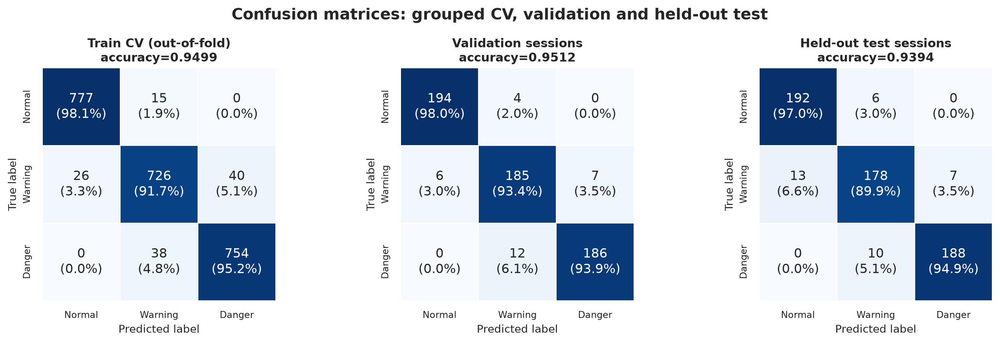

# Smart Gas Detection System — An Interdisciplinary AI/ML Project

A compact, reproducible gas-level classifier for an **ESP32 + MQ-5** prototype.
Raw 12-bit ADC readings are classified as **Normal**, **Warning** or **Danger**
by a Gaussian Naive Bayes model that is trained in Python and exported as a
header-only C implementation for the microcontroller.

## Team Credits and Interdisciplinary Collaboration

**Smart Gas AI — An Interdisciplinary AI/ML Project**

Smart Gas AI is an interdisciplinary academic project integrating Artificial Intelligence and Machine Learning (AI/ML), chemical engineering concepts, electronics and communication systems, and computer science to develop an ESP32-based gas-sensor classification prototype.

### Project Team

| Team Member | Department |
|---|---|
| Amrutha S | Chemical Engineering |
| Ann Treesa George | Electronics and Communication Engineering (ECE) |
| Bensen Thomas | Computer Science and Engineering (CSE) |
| Fiona Joby Varghese | Computer Science and Engineering (CSE) |

### Interdisciplinary Collaboration

The project combines expertise from multiple engineering disciplines to explore machine learning-based classification of MQ-5 gas-sensor readings. It incorporates AI/ML model development and evaluation, sensor interfacing, embedded systems programming, and the interpretation of gas-related sensor data.

This collaboration demonstrates how different engineering disciplines can contribute to a common technological objective: developing and evaluating an intelligent gas-level classification prototype.

**Note:** The system is an experimental academic prototype. Its dataset-based performance does not establish real-world gas-leak detection accuracy or certified safety performance.


## What this repository contains

- A verified Python pipeline: dataset integrity check, session-grouped split,
  leave-one-session-out model comparison, final fit, held-out evaluation and
  embedded export.
- The **actually deployed** model: `StandardScaler` + `GaussianNB` on `mq5_adc`
  only. Random Forest and Logistic Regression were evaluated but are **not**
  deployed.
- ESP32 firmware for the MQ-5 on **GPIO34** with green/yellow/red LEDs on
  **GPIO25/26/27**. There is no buzzer.
- Generated model artifacts, evaluation metrics, plots, a model card, an
  executed EDA notebook and a dependency-free local dashboard.

## Results at a glance

The test sessions were held out before model selection and used once.

| Evaluation | Rows | Sessions | Accuracy | Macro F1 |
|---|---:|---:|---:|---:|
| Leave-one-session-out CV (training sessions) | 2,376 | 12 | 0.9499 | 0.9498 ± 0.0181 |
| Validation | 594 | 3 | 0.9512 | 0.9512 |
| **Held-out test** | **594** | **3** | **0.9394** | **0.9393** |
| Two-threshold rule baseline (test) | 594 | 3 | 0.9411 | 0.9409 |

Additional held-out test results:

- Danger recall: **0.9495**; **0 Danger → Normal** errors.
- 36 errors out of 594 rows; accuracy 95% Wilson CI **[0.9172, 0.9559]**.
- Top-label ECE **0.0117**, MCE **0.2574** (measured, not recalibrated).
- McNemar exact test against the rule baseline: **p = 1.0**. The ML model does not
  show a statistically significant accuracy advantage on this dataset.

Confusion matrix (rows = true, columns = predicted):

| True \ Predicted | Normal | Warning | Danger |
|---|---:|---:|---:|
| Normal | 192 | 6 | 0 |
| Warning | 13 | 178 | 7 |
| Danger | 0 | 10 | 188 |



## Hardware

| Function | ESP32 pin | Firmware constant | Behaviour |
|---|---|---|---|
| MQ-5 analog output | **GPIO34** | `MQ5_PIN` | 12-bit ADC, `ADC_11db` attenuation |
| Green LED | **GPIO25** | `GREEN_LED` | On for `Normal` |
| Yellow LED | **GPIO26** | `YELLOW_LED` | On for `Warning` |
| Red LED | **GPIO27** | `RED_LED` | On for `Danger` |

GPIO34 is an input-only ESP32 pin and belongs to ADC1. The sketch configures
`analogReadResolution(12)` and `analogSetPinAttenuation(MQ5_PIN, ADC_11db)`.

The sketch does **not** define the MQ-5 supply wiring. MQ-5 modules commonly use
a 5 V heater supply; make sure the analog output presented to GPIO34 never
exceeds the ESP32's 3.3 V ADC range. Use a suitable divider or level shifter if
your module outputs a higher voltage. Use series resistors for the LEDs.

## Quick start

### 1. Python environment

Use Python 3.11 or newer. The checked-in results were produced with Python
3.14.4 on Windows 11.

```bash
python -m venv .venv
# Windows: .venv\Scripts\activate
# Linux/macOS: source .venv/bin/activate
pip install -r requirements.txt
```

### 2. Reproduce the pipeline

Run these commands from the repository root, in order:

```bash
python -m src.data_preprocessing
python -m src.train
python -m src.evaluate
python -m src.export_embedded
```

`src.data_preprocessing` verifies the raw CSV checksum before writing the
session-grouped splits. `src.train` compares candidates with grouped CV and
writes the selected model. `src.evaluate` produces the metrics and plots.
`src.export_embedded` regenerates `firmware/esp32_gas_detection/gas_model.h`,
the model card and the host C/Python parity log.

### 3. Classify a reading

```bash
python -m src.predict --adc 1500
python -m src.predict --adc 2800 --json
python -m src.predict --interactive
```

Temperature and humidity may be supplied for context, but they are not model
features:

```bash
python -m src.predict --adc 1500 --temperature 28.0 --humidity 70
```

### 4. Run the tests

```bash
python -m unittest discover -s tests -v
```

The suite covers the dataset contract, split isolation, input validation,
inference, exported C constants, host parity metadata and the dashboard API.

## Firmware

1. Open `firmware/esp32_gas_detection/esp32_gas_detection.ino` in the Arduino
   IDE with ESP32 board support installed.
2. Keep `gas_model.h` in the same folder as the sketch. It is generated; do not
   hand-edit it.
3. Select a compatible ESP32 board (a generic ESP32 Dev Module is a reasonable
   starting point) and upload.
4. Open the Serial Monitor at **115200 baud**.

The firmware prints a CSV header once and then one row per second:

```text
raw_adc,class,prob_normal,prob_warning,prob_danger
1800,Warning,0.0000,0.9839,0.0161
```

The LEDs are updated from the model's argmax class. The probability output is
preserved for logging. See `firmware/esp32_gas_detection/README.md` for details.

## Dataset

- **3,564 rows**, **18 sessions**, **5 columns**, exactly **1,188 rows per class**.
- Columns: `session_id`, `mq5_adc`, `temperature_c`, `humidity_rh_pct`, `label`.
- No missing cells, duplicate rows or duplicate feature rows.
- Raw SHA-256:
  `82BFC7557E247D06E54C7B81AD5F2A9A294C5A44FD006274D451C6D99F1F01C7`.
- Split: 12 training sessions / 3 validation sessions / 3 test sessions, with no
  session overlap. Test sessions: `ENC_01`, `ENC_02`, `ENC_09`.
- The supplied dataset is synthetic/enclosed. Its original provenance and
  licensing could not be verified.

See `docs/dataset.md` and `data/README.md`.

## Model

The deployed candidate is `gaussian_nb_adc`:

- `StandardScaler` fitted on the training partition.
- `GaussianNB` on one feature, `mq5_adc`.
- 56 bytes of float32 constants in the exported C header.
- Host C/Python parity: **165/165 cases**, maximum probability difference
  **2.38e-07** (tolerance `1e-4`).

Candidate selection used mean leave-one-session-out CV macro-F1 on the 12
training sessions, with a fixed tie rule: if candidates are within `0.001`,
choose the smallest serialized model. Logistic Regression scored slightly higher
(0.9506) but serialized to 952 bytes; GaussianNB scored 0.9498 and serialized to
885 bytes, so GaussianNB won the tie-break. QDA had the same CV score as
GaussianNB but a larger artifact and lower embedded-suitability rating.

The model is **not deployment-qualified**: it has been host-compiled and
parity-tested, not cross-compiled or run on an ESP32, and not validated against a
real sensor. See `models/model_card.json` and `docs/limitations.md`.

## Repository layout

```text
smart-gas-ai-release/
├── data/
│   ├── raw/                  # immutable supplied CSV
│   ├── processed/            # generated splits, metadata and predictions
│   └── sample/               # small illustrative sample
├── docs/                     # architecture, dataset, model, hardware, limits
├── firmware/esp32_gas_detection/
│   ├── esp32_gas_detection.ino
│   └── gas_model.h           # generated C classifier
├── models/                   # fitted model, model card, export metadata
├── notebooks/                # executed EDA notebook
├── results/
│   ├── metrics/              # metrics, reports, parity log
│   └── plots/                # generated figures
├── src/                      # preprocessing, training, evaluation, export, CLI
├── tests/                    # unittest suite
├── LICENSE
├── requirements.txt
└── README.md
```

## Documentation

- [Architecture](docs/architecture.md) — pipeline and data flow.
- [Dataset](docs/dataset.md) — schema, statistics, split and provenance.
- [Model](docs/model.md) — candidate comparison, metrics and embedded export.
- [Hardware](docs/hardware.md) — pinout, ADC configuration and serial protocol.
- [Reproduction](docs/reproduction.md) — exact commands and expected outputs.
- [Limitations](docs/limitations.md) — what these results do and do not prove.

## License and dataset provenance

The source code and documentation are released under the [MIT License](LICENSE).
The dataset is included for reproducibility, but its original license and
provenance could not be verified; confirm permission before redistributing it.
The MIT license does not automatically grant rights to the dataset.
