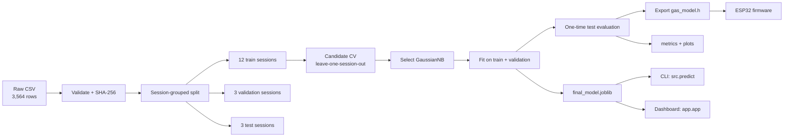

# Architecture

The project has one offline training pipeline and three inference paths that all
share the same frozen model contract.



## Stages

| Stage | Entry point | Main inputs | Main outputs |
|---|---|---|---|
| Prepare | `python -m src.data_preprocessing` | `data/raw/smart_gas_ai_enclosed_synthetic_dataset.csv` | `data/processed/{train,validation,test}.csv`, `metadata.json`, `split_manifest.json`, `dataset_summary.txt`, `data/sample/sample_readings.csv` |
| Train | `python -m src.train` | processed train/validation splits | `models/final_model.joblib`, `models/selected_model_train.joblib`, `models/selected_model.json`, `models/candidate_configs.json`, `results/metrics/model_comparison.csv`, `results/metrics/cv_fold_metrics.csv`, `results/metrics/model_selection.md` |
| Evaluate | `python -m src.evaluate` | final model, processed splits, CV predictions | `results/metrics/metrics.json`, classification reports, confusion matrices, per-session metrics, calibration bins, `results/plots/*.png` |
| Export | `python -m src.export_embedded` | final model, metrics, metadata | `firmware/esp32_gas_detection/gas_model.h`, `models/gas_model.json`, `models/model_card.json`, `models/test_vectors.csv`, `results/metrics/embedded_parity.txt` |
| Predict | `python -m src.predict` | final model + selected metadata | terminal or JSON result |
| Dashboard | `python app/app.py` | final model + selected metadata + model card | local HTTP page and JSON API |

The stages are intentionally ordered. `train` needs the processed splits;
`evaluate` needs the trained artifacts; `export` needs the evaluated metrics and
the final model.

## Data contract

The raw file must contain exactly these columns:

| Column | Type | Role |
|---|---|---|
| `session_id` | string | Group identifier used for splitting and CV |
| `mq5_adc` | numeric | **Only model feature**, 0..4095 |
| `temperature_c` | numeric | Context only |
| `humidity_rh_pct` | numeric | Context only |
| `label` | string | `Normal`, `Warning` or `Danger` |

Preparation validates the schema, value ranges, class labels, missing values,
duplicates and checksum. Any violation aborts the pipeline rather than silently
dropping rows. The raw CSV is opened read-only and is never rewritten.

## Split protocol

1. Shuffle the 18 session IDs with seed 42.
2. Hold out 3 sessions for test.
3. From the remaining 15, hold out 3 for validation.
4. Keep the remaining 12 for training and leave-one-session-out CV.

The resulting assignment is pinned in `src/config.py` as `EXPECTED_SPLIT` and is
reproduced in `data/processed/split_manifest.json`. No row or session appears in
more than one partition.

## Model contract

- Feature order: `["mq5_adc"]`.
- Preprocessing: `StandardScaler` fitted inside each CV fold and again for the
  final fit.
- Estimator: `GaussianNB`.
- Class order: `Normal`, `Warning`, `Danger`.
- Input domain: raw 12-bit ADC counts, 0..4095.
- Probability output: three values that sum to 1.

The same contract is enforced in `src/predict.py`, `app/app.py`, the tests and
the generated C header. Temperature and humidity are accepted as optional
context by the Python API, but are deliberately excluded from the feature frame.

## Why the deployed model is small

The ESP32 must evaluate the classifier without a Python runtime. A Gaussian
Naive Bayes model with one feature reduces to:

```text
z         = (adc - mean) / scale
logit_c   = log(prior_c) - 0.5*log(2*pi*var_c) - 0.5*((z - theta_c)^2 / var_c)
p_c       = softmax(logit_c)
```

That is one standardisation, three quadratic scores and a three-way softmax.
The exported constants occupy 56 bytes as float32. There is no dynamic
allocation and no external ML library on the device.

## Inference paths

| Path | Runtime | Input | Output |
|---|---|---|---|
| `src.predict` | Python + scikit-learn | ADC, optional context | text or JSON |
| `app.app` | Python stdlib + scikit-learn | ADC query parameter | HTML + JSON API |
| `esp32_gas_detection.ino` | ESP32 Arduino core | `analogRead(34)` | LEDs + CSV serial line |

The Python paths load `models/final_model.joblib` and `models/selected_model.json`.
The firmware uses only `gas_model.h`, which is generated from the same fitted
pipeline. `results/metrics/embedded_parity.txt` records the host C/Python
comparison.

## Failure behaviour

- Checksum mismatch: preparation, training, evaluation and export abort.
- Missing/invalid columns or labels: preparation raises `DatasetValidationError`.
- ADC outside 0..4095, non-finite or non-numeric: prediction rejects the input.
- Missing model artifacts: prediction and dashboard exit with a clear message.
- Dashboard binds to `127.0.0.1` by default and serves the page plus
  `/healthz`, `/api/info` and `/api/predict`.

## What is intentionally absent

- No cloud service, database or message broker.
- No buzzer support.
- No DHT sensor dependency in the firmware.
- No automatic alarm or safety interlock. A real system would need an
  independent fail-safe path that does not depend on the ML model.
